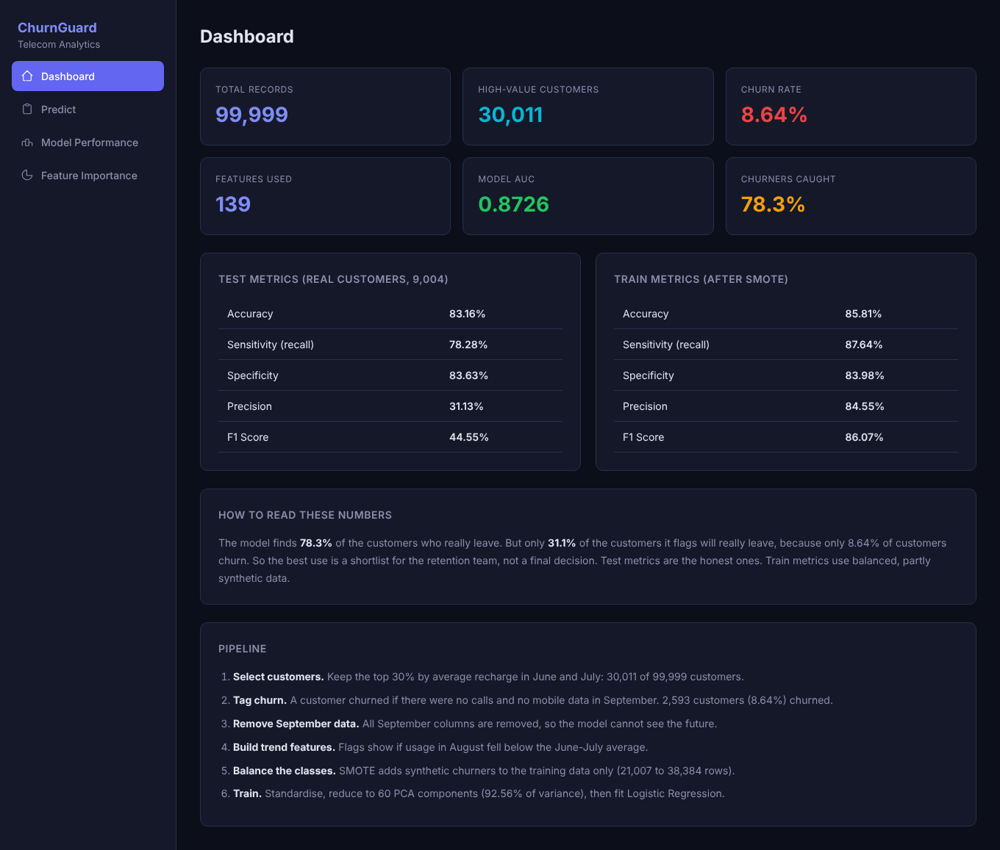
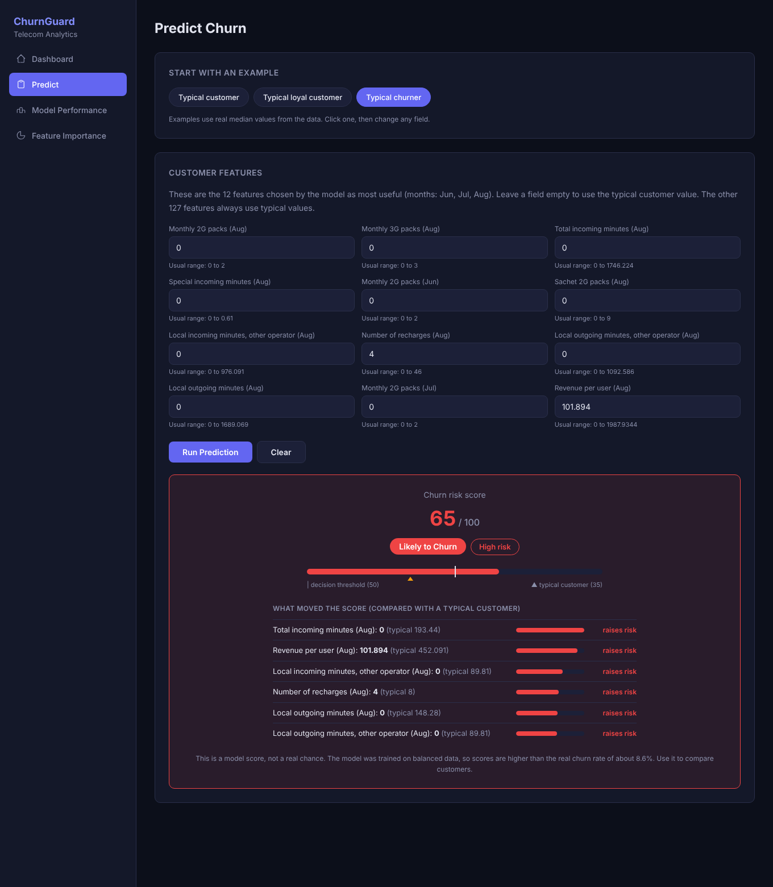
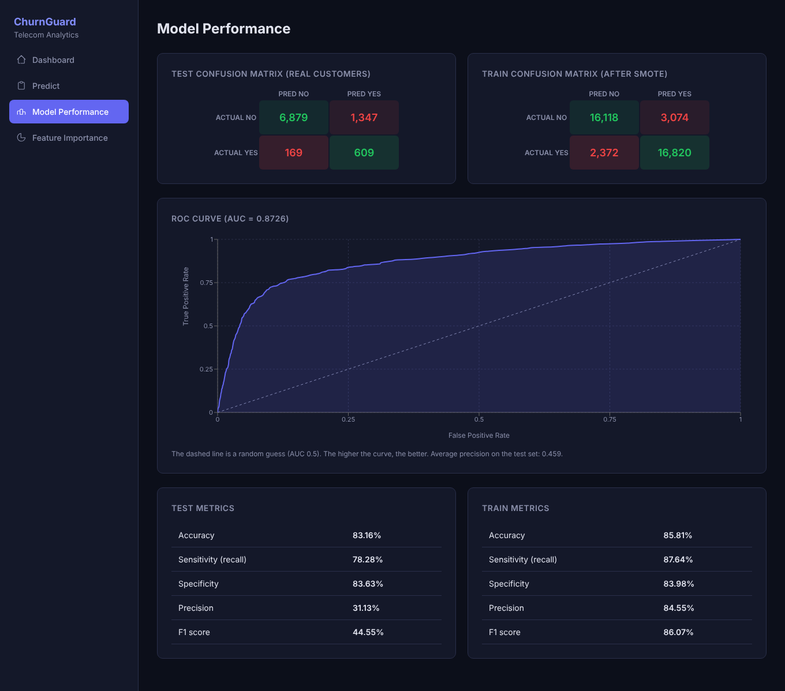
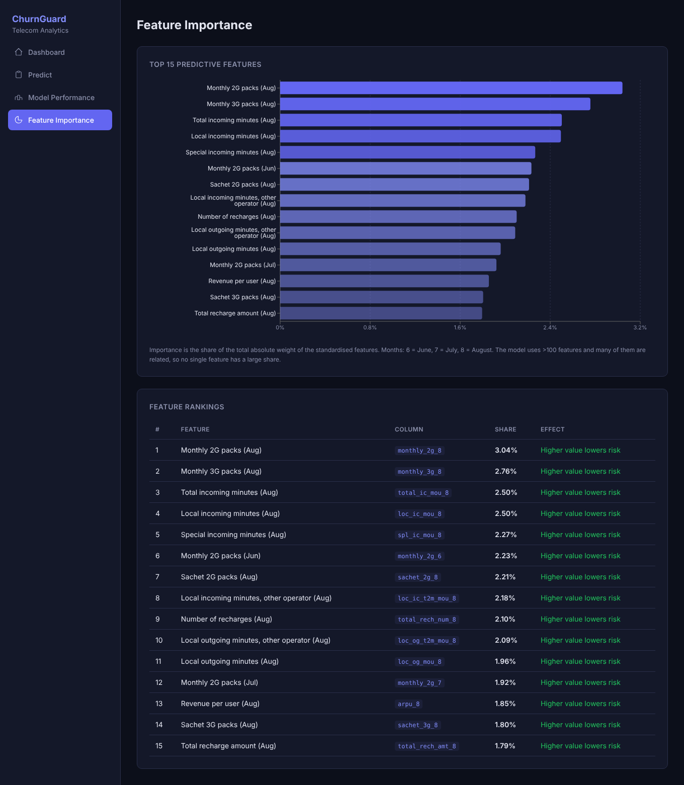

# ChurnGuard - Telecom Churn Prediction (Full Stack)

A full-stack web application that predicts which telecom customers are likely to **churn** (stop using the service).
It has a React dashboard, a Flask API and a machine learning model built with scikit-learn.



## Table of contents

1. [What this project does](#1-what-this-project-does)
2. [Screenshots](#2-screenshots)
3. [Tech stack](#3-tech-stack)
4. [Project structure](#4-project-structure)
5. [The dataset](#5-the-dataset)
6. [How the machine learning works](#6-how-the-machine-learning-works)
7. [Results](#7-results)
8. [Run it on your computer](#8-run-it-on-your-computer)
9. [Train the model again](#9-train-the-model-again)
10. [API reference](#10-api-reference)
11. [Deploy on Vercel](#11-deploy-on-vercel)
12. [Tests](#12-tests)
13. [Limitations](#13-limitations)
14. [Troubleshooting](#14-troubleshooting)
15. [Ideas for the future](#15-ideas-for-the-future)

---

## 1. What this project does

Telecom companies lose money when good customers leave. It costs much more to find a new customer than to keep an old one.
This project helps to find customers who are **at risk of leaving**, so the company can contact them early with an offer.

The web app has four pages:

| Page | What you can do |
|------|-----------------|
| **Dashboard** | See the size of the data, the churn rate, the main model scores and the steps of the pipeline. |
| **Predict** | Enter customer details (or click an example) and get a churn **risk score**, a risk level, and the reasons for the score. |
| **Model Performance** | See the confusion matrices, the ROC curve and all the metrics. |
| **Feature Importance** | See which customer behaviours matter most to the model. |

## 2. Screenshots

**Predict page** - choose an example or type values. The result shows the score, the risk level and what moved the score.



**Model Performance** - confusion matrices and ROC curve.



**Feature Importance** - the 15 features with the largest weight in the model.



The app also works on a phone: [mobile screenshot](docs/screenshots/mobile-predict.png).

## 3. Tech stack

| Part | Technology |
|------|-----------|
| Frontend | React 18, Vite, React Router, Recharts, Axios |
| Backend | Python, Flask |
| Machine learning | pandas, scikit-learn, imbalanced-learn (SMOTE) |
| Hosting | Vercel (React site + Python serverless function) |
| Tests | pytest |

## 4. Project structure

```
Telecom-churn/
├── api/
│   └── index.py              # Entry point for Vercel (loads the Flask app)
├── backend/
│   ├── app.py                # Flask API (all /api/... routes)
│   ├── predictor.py          # Prediction logic (standard library only, no scikit-learn)
│   ├── train.py              # Offline training script (creates artifacts/model.json)
│   ├── artifacts/
│   │   └── model.json        # The trained model as plain numbers (about 36 KB)
│   ├── data/                 # Put telecom_churn_data.csv here (only needed to re-train)
│   ├── tests/
│   │   └── test_api.py       # API tests
│   ├── requirements-train.txt
│   └── requirements-dev.txt
├── frontend/
│   ├── src/
│   │   ├── pages/            # Dashboard, Predict, ModelPerformance, Features
│   │   ├── components/       # Loading and error components
│   │   ├── hooks/            # useFetch hook
│   │   ├── services/api.js   # Axios client
│   │   └── styles.css
│   ├── index.html
│   ├── package.json
│   └── vite.config.js
├── docs/screenshots/         # Images used in this README
├── requirements.txt          # Runtime Python requirements (Flask only)
├── vercel.json               # Vercel build and routing settings
├── .vercelignore             # Files that Vercel must not upload
└── README.md
```

### Why is the model saved as JSON?

The first version of this project trained the model **when the server started**. It needed the 79 MB dataset, pandas and
scikit-learn, and it took about 30 seconds. That does not work on Vercel, because serverless functions have a small size
limit, a read-only disk and short run times.

Now the training is done **once** by `backend/train.py`. It saves the result in `backend/artifacts/model.json`.
The API only reads this small file and does simple maths. So the API needs only **Flask**, and it starts at once.

## 5. The dataset

- File: `backend/data/telecom_churn_data.csv` (79 MB, **not stored in Git** because it is large).
- Size: 99,999 customers and 226 columns.
- Content: usage and recharge information for four months. Months 6, 7 and 8 (June, July, August) are the
  "good" and "action" phases. Month 9 (September) is the "churn phase".
- Dataset source: *add the link to your dataset here (for example the website where you downloaded it).*

Important column groups:

| Example column | Meaning |
|----------------|---------|
| `arpu_8` | Average revenue per user in August |
| `total_ic_mou_8` / `total_og_mou_8` | Total incoming / outgoing call minutes in August |
| `total_rech_num_8` / `total_rech_amt_8` | Number / amount of recharges in August |
| `vol_2g_mb_8` / `vol_3g_mb_8` | Mobile data used in August |
| `monthly_2g_8`, `sachet_3g_8` | Data packs bought in August |
| `aon` | Age on network (how many days the customer has been with the company) |

You only need the dataset if you want to **re-train** the model. To run the app, you do not need it.

## 6. How the machine learning works

The pipeline is in `backend/train.py`.

**Step 1 - Clean the data.**
Remove columns with more than 30% missing values. Remove date columns and `circle_id`.

**Step 2 - Keep only high-value customers.**
We keep customers whose average recharge amount in June and July is in the **top 30%**.
These customers bring most of the revenue, so losing them costs the most.
This gives **30,011 customers**.

**Step 3 - Tag churn.**
A customer is tagged as *churned* if, in September, they made **no calls** (incoming or outgoing) and used **no mobile data**.
This gives **2,593 churners (8.64%)**. The data is imbalanced: most customers stay.

**Step 4 - Remove all September data.**
The model must predict churn *before* it happens. So every September column is removed.
This includes `sep_vbc_3g`, which does not end with `_9` but is also September data.
(The first version of the project kept this column. That was a small **data leakage**. See the note below.)

**Step 5 - Create trend features.**
Five yes/no features show if the August value fell below the average of June and July. They are made for
outgoing minutes, number of recharges, recharge amount, revenue per user and 3G volume cost.
A fall in usage is a strong warning sign.

**Step 6 - Split, balance, scale, reduce, train.**
1. Split into 70% train and 30% test (stratified, so both parts have the same churn rate).
2. **SMOTE** creates synthetic churners, only in the **train** part (21,007 rows become 38,384 rows).
   The test part stays real. This is important for honest results.
3. **StandardScaler** puts all features on the same scale.
4. **PCA** reduces 139 features to 60 components (keeps 92.56% of the information).
5. **Logistic Regression** learns to separate churners from the others.

**Step 7 - Pack the model.**
Scaler, PCA and Logistic Regression are all linear steps. So they can be joined into one formula with one weight per feature:

```
z_j    = (x_j - mean_j) / scale_j
logit  = intercept + sum_j weight_j * (z_j - pca_mean_j)
score  = 1 / (1 + exp(-logit))
```

`train.py` checks that this formula gives the **same answers as scikit-learn** (the difference is about 2e-15)
before it saves the file. A good side effect: every feature has its own weight, so the app can show **why** a customer got a score.

### Risk score and risk level

- The **risk score** is a number from 0 to 100. A score of 50 or more is predicted as "Churn".
- **Risk level**: Low (below 40), Medium (40 to 59), High (60 or more).
- The score is **not** the real chance of leaving. The model was trained on balanced data, so the scores are higher than the
  real churn rate of 8.6%. A typical customer scores about 35. Use the score to **compare customers**.

### Note on the data leakage fix

The first version of the project kept `sep_vbc_3g` (September 3G volume cost) as a feature, and its Predict page asked for it.
September is the month used to define churn, so this column gives the model information from the future.
It was removed. The effect was small (AUC changed from 0.8747 to 0.8726), but the result is now honest.

## 7. Results

Results on the **test set** (9,004 real customers that the model did not see during training):

| Metric | Value | Meaning |
|--------|-------|---------|
| Accuracy | 83.16% | Share of all customers classified correctly |
| Sensitivity (recall) | 78.28% | Of the customers who really left, the model found 78% |
| Specificity | 83.63% | Of the customers who stayed, the model correctly said "stay" for 84% |
| Precision | 31.13% | Of the customers the model flagged, 31% really left |
| F1 score | 44.55% | Balance of precision and recall |
| ROC AUC | 0.8726 | Ability to rank churners above non-churners (0.5 = random, 1.0 = perfect) |
| Average precision | 0.459 | Area under the precision-recall curve (random would be about 0.09) |

Test confusion matrix:

|  | Predicted: stay | Predicted: churn |
|--|-----------------|------------------|
| **Actually stayed** | 6,879 | 1,347 |
| **Actually churned** | 169 | 609 |

**How to read this:** the model finds most churners (78%), but it also flags many customers who would have stayed.
Precision is low because only 8.6% of customers churn. The best use is a **shortlist for the retention team**, not an automatic decision.

The train metrics on the dashboard (accuracy 85.8%) are measured on the SMOTE-balanced train data, so they are only for comparison.
The test metrics are the honest ones.

### What the model learned

The strongest signals are about **activity in August**: customers who buy fewer data packs, receive fewer calls, make fewer
calls and recharge less in August are more likely to leave. All of the top 15 features lower the risk when their value is higher.

## 8. Run it on your computer

You need **Python 3.10 or newer** and **Node.js 18 or newer**.

### Step 1 - Start the backend (API)

macOS / Linux:

```bash
python3 -m venv .venv
source .venv/bin/activate
pip install -r requirements.txt
python backend/app.py
```

Windows (PowerShell):

```powershell
python -m venv .venv
.venv\Scripts\Activate.ps1
pip install -r requirements.txt
python backend/app.py
```

The API runs on http://127.0.0.1:5000. Test it: open http://127.0.0.1:5000/api/health. You should see `{"status":"ok"}`.

### Step 2 - Start the frontend (in a second terminal)

```bash
cd frontend
npm install
npm run dev
```

Open http://localhost:3000. The dev server sends every `/api/...` request to the Flask server on port 5000.

You do **not** need the dataset or scikit-learn for these steps.

## 9. Train the model again

Do this only if you change the pipeline or the data.

```bash
# 1. Put the dataset here: backend/data/telecom_churn_data.csv
# 2. Install the training libraries
pip install -r backend/requirements-train.txt
# 3. Train (takes a few seconds on a normal computer)
python backend/train.py
```

This overwrites `backend/artifacts/model.json`. Restart the Flask server after training, because it reads the file once at start.
Commit the new `model.json` to Git so that Vercel uses it.

The script prints the main numbers and checks that the packed model matches scikit-learn.

## 10. API reference

Base URL: `http://127.0.0.1:5000` (local) or `https://<your-project>.vercel.app` (deployed). All responses are JSON.

| Method | Endpoint | Description |
|--------|----------|-------------|
| GET | `/api/health` | Health check |
| GET | `/api/stats` | Dataset statistics (records, high-value customers, churn rate, feature count) |
| GET | `/api/metrics` | Train and test metrics, confusion matrices, AUC |
| GET | `/api/features` | Top 15 features with labels and share of importance |
| GET | `/api/roc` | Points of the ROC curve |
| GET | `/api/feature-cols` | Names of all 139 model features |
| GET | `/api/schema` | Inputs for the Predict form: labels, typical values, ranges, examples |
| POST | `/api/predict` | Predict churn for one customer |

### POST /api/predict

Send any of the 139 feature names with a number. Missing features use the typical (median) value.

```bash
curl -X POST http://127.0.0.1:5000/api/predict \
  -H "Content-Type: application/json" \
  -d '{"total_ic_mou_8": 0, "arpu_8": 101.9}'
```

Response:

```json
{
  "score": 0.4746,
  "prediction": "No Churn",
  "risk_level": "Medium",
  "baseline_score": 0.3457,
  "threshold": 0.5,
  "factors": [
    {
      "feature": "total_ic_mou_8",
      "label": "Total incoming minutes (Aug)",
      "value": 0.0,
      "typical": 193.44,
      "effect": 0.2828,
      "direction": "raises risk"
    }
  ],
  "provided_count": 2,
  "default_count": 137,
  "ignored": []
}
```

| Field | Meaning |
|-------|---------|
| `score` | Model score from 0 to 1 |
| `prediction` | `Churn` if the score is at least `threshold` |
| `risk_level` | `Low`, `Medium` or `High` |
| `baseline_score` | Score of a typical customer, for comparison |
| `factors` | The values you entered that moved the score most. `effect` is the change in log-odds (positive raises the risk) |
| `ignored` | Names that are not model features (they are ignored) |

Errors return HTTP 400 with a message, for example `{"error": "'arpu_8' must be a number."}`.
Bodies larger than 64 KB are refused.

## 11. Deploy on Vercel

The project is ready for Vercel. The React site is built from `frontend/`, and the Flask API runs as a Python function from `api/index.py`.
Everything is set in `vercel.json`, so you do not need to change any build settings.

### Before you start

1. Check that `backend/artifacts/model.json` is in your Git repository. The API cannot work without it.
2. Do **not** upload the 79 MB dataset. `.gitignore` and `.vercelignore` already exclude it.
   If the CSV is already in your Git history, remove it from tracking:

   ```bash
   git rm --cached backend/data/telecom_churn_data.csv
   git commit -m "Stop tracking the large dataset"
   ```

### Option A - From the Vercel website (easiest)

1. Push the project to GitHub.
2. Go to https://vercel.com/new and import your repository.
3. Keep **Root Directory** as the repository root. Keep **Framework Preset** as **Other**.
   Vercel reads the install, build and output settings from `vercel.json`.
4. Click **Deploy**. No environment variables are needed.
5. When it is ready, open `https://<your-project>.vercel.app/api/health`. You should see `{"status":"ok"}`. Then open the site.

Every `git push` to the main branch will deploy again automatically.

### Option B - From the command line

```bash
npm install -g vercel
vercel login
vercel          # preview deployment
vercel --prod   # production deployment
```

### How the routing works

`vercel.json` sends every `/api/...` request to the Python function and every other path to the React app (`index.html`),
so page refreshes on `/predict` and other routes work.

## 12. Tests

```bash
pip install -r backend/requirements-dev.txt
pytest backend/tests -v
```

The 26 tests check: all endpoints, the fields used by the frontend, that no September columns are used,
that the "typical churner" example scores higher than the "loyal customer" example, and that wrong input
(text, empty values, huge numbers, wrong JSON) is refused with a clear error.

## 13. Limitations

- **Scores are not real probabilities.** See [Risk score and risk level](#risk-score-and-risk-level).
- **Low precision (31%).** Many flagged customers would have stayed. This is normal for a rare event, but it matters for cost.
- **Only high-value customers.** The model was trained on the top 30% by recharge amount. Do not use it for all customers.
- **Churn definition.** "No calls and no data in September" is a practical rule. It does not know why the customer left.
- **Simple model.** Logistic Regression is easy to explain, but gradient boosting may give a better score. See the ideas below.
- **The Predict page has inputs for 12 features.** The other 127 use typical values. For full control, call the API with any of the 139 features.
- **Data is from one period.** The patterns may change over time, so the model must be re-trained with new data.

## 14. Troubleshooting

| Problem | Solution |
|---------|----------|
| Frontend shows "Could not load data from the API" | The backend is not running. Start it with `python backend/app.py`. |
| `Model file not found` | `backend/artifacts/model.json` is missing. Run `python backend/train.py` (needs the dataset). |
| `Dataset not found` when training | Put `telecom_churn_data.csv` in `backend/data/`. |
| Port 5000 or 3000 is already in use | Close the other program, or change the port in `backend/app.py` and `frontend/vite.config.js`. |
| `/api/...` returns 404 on Vercel | Check that `vercel.json` and `api/index.py` are in the repository root. |
| Vercel build fails on the frontend | Run `npm --prefix frontend install && npm --prefix frontend run build` locally to see the error. |
| API error on Vercel (500) | Open the function logs in the Vercel dashboard. Check that `backend/artifacts/model.json` is committed. |
| Predictions look wrong after re-training | Restart the Flask server. It reads `model.json` only once. |

## 15. Ideas for the future

- Try gradient boosting (XGBoost or LightGBM) and compare it with Logistic Regression.
- Calibrate the probabilities so that the score matches the real churn rate.
- Choose the decision threshold from business cost (cost of an offer versus value of a saved customer).
- Add CSV upload to score many customers at once.
- Add SHAP explanations for non-linear models.
- Add user login and a history of predictions.

---

Built as a learning project. The code is commented so that you can read and change it.
# Telecom-Churn
